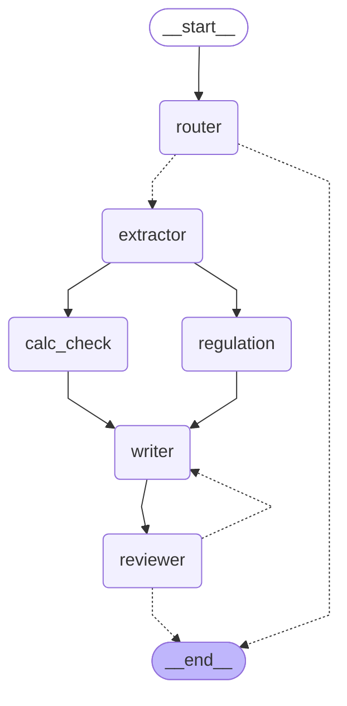

# 輸入書類チェック・マルチエージェント（LangGraph デモ）

コマーシャルインボイスを読み、通関前のチェックレポートを自動で作る LangGraph のデモです。
役割の違う複数のエージェントを「グラフ」としてつなぎ、レビューで NG が出たら差し戻して書き直させます。

## グラフ構成



（点線は条件分岐。図は `draw_graph.py` でコードから生成）

| ノード | 担当 | モデル | 役割 |
|---|---|---|---|
| router | 振り分け役 | Haiku 4.5 | 書類の種類を判定。インボイス以外は「対象外」で終了 |
| extractor | 書類読取 | Haiku 4.5 | 番号・当事者・明細などを構造化データとして抽出 |
| calc_check | 計算チェック | **LLMなし（Python）** | 記載漏れ、数量×単価、合計を計算で確定 |
| regulation | 規制チェック | Sonnet 5.5 | 品目ごとの関連法規と必要書類を検討 |
| writer | レポート作成 | Sonnet 5.5 | 上の2つを合わせてレポートを作成 |
| reviewer | レビュー役 | Haiku 4.5 | 合否判定。NG なら修正指示を付けて writer へ差し戻す（最大3回） |

## 設計で工夫した点

- **AI に計算させない**：金額の検算は Python で行い、結果を「確定事実」として writer と reviewer に渡す。AIの計算ミスがレポートに入らない
- **並列実行と合流**：calc_check と regulation は同時に走らせ、両方が終わってから writer で合流する（`add_edge([...], "writer")`）
- **マルチモデルで費用を最適化**：判定・抽出・レビューは安い Haiku、考える仕事だけ Sonnet に任せる
- **差し戻しループが終わらない問題の対策**：前回の指摘を reviewer に渡し、「指摘が解消されていれば承認、新しい要求は追加しない」という基準にした
- **ノードごとのコスト記録**：各呼び出しのトークン数と料金を State に蓄積する（並列ノードからも追記できるよう reducer を使用）

## 実行結果の例（samples/invoice_001.txt）

```
===== プログラムで確認した不備 =====
- 明細2（Ceramic coated frying pan 26cm）の金額が合わない: 800 × 9.50 = 7,600.00 だが記載は 7,800.00
- 明細4（Plastic food container set）にHSコードがない
- 合計が合わない: 明細金額の和は 17,040.00 だが記載は 16,940.00
[round 1] OK

===== コスト =====
node       model                            in    out       USD
router     claude-haiku-4-5-20251001      1147    135    0.0018
extractor  claude-haiku-4-5-20251001      1625    514    0.0042
regulation claude-sonnet-5-5               265   1909    0.0196
writer     claude-sonnet-5-5              2675   3077    0.0361
reviewer   claude-haiku-4-5-20251001      4550     48    0.0048
合計                                            10262   5683    0.0665
```

インボイス1枚あたり約 0.07 USD（約10円）。パッキングリストを入れた場合は router だけで終わり、0.002 USD でした。
全文は `runs/` にあります。

## 開発中にハマった点

1. **Sonnet 5.5 の本文が空になる**：thinking が既定でオンのため、`max_tokens` を思考で使い切っていた。本文だけを取り出し（`.text`）、`stop_reason` を検査し、effort を `medium` に下げて解決
2. **レビュー役が毎回新しい要求を足し、3回とも NG**：ゴールが毎回変わっていた。前回の指摘を渡し、解消したかどうかで判定させて解決

## 使い方

```bash
python3.12 -m venv .venv
.venv/bin/pip install -r requirements.txt
export ANTHROPIC_API_KEY=...        # キーはファイルに置かず環境変数で渡す

.venv/bin/python test_loop.py                      # API を使わないテスト（6件）
.venv/bin/python main.py samples/invoice_001.txt   # 実行（結果は runs/ にも保存）
.venv/bin/python draw_graph.py                     # グラフ図を graph.mmd に出力
```

## ファイル構成

| ファイル | 内容 |
|---|---|
| `graph.py` | State・ノード・グラフ定義、計算チェック |
| `costs.py` | 料金表とコスト集計 |
| `config.py` | モデル名、差し戻し上限、API キーの読み込み |
| `main.py` | 実行用 CLI |
| `test_loop.py` | Fake モデルでの分岐・ループ・コスト記録のテスト |
| `draw_graph.py` | Mermaid 図の出力 |

使用ライブラリ：langgraph 1.2.14 / langchain-anthropic 1.7.5（Python 3.12）

※ サンプル書類は架空のものです。法規の判断は参考情報であり、実際の通関では税関・専門家に確認してください。
